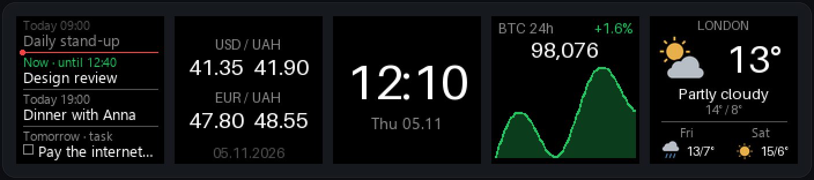
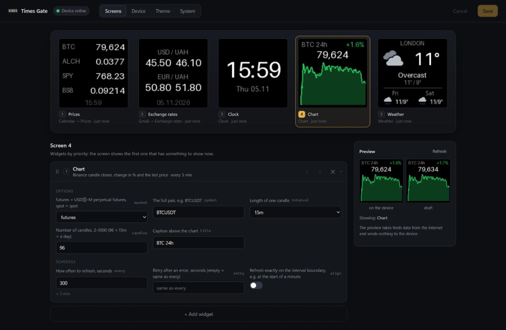

# Divoom Times Gate

One small Python program that drives the five screens of a **Divoom Times Gate** over the device's local HTTP API: Google Calendar events and tasks, crypto/futures prices, exchange rates, a clock, a price chart, the weather and the Gmail unread count. It has a local settings page, a tray icon and Windows autostart.





Protocol reference: [raishack/divoom-times-gate-controller](https://github.com/raishack/divoom-times-gate-controller).

> **Language.** `[ui] language = "en"` (default) or `"uk"` switches the words on the screens (weekdays, calendar, Gmail), the settings page and the tray menu between English and Ukrainian. Translations live in [timesgate/i18n.py](timesgate/i18n.py): the source text is English and `UK` maps it to Ukrainian; a text without a translation stays English. The weather's sky label is always English (Pillow's default font has no Cyrillic).

## Requirements

- Python 3.11+ (`tomllib`).
- The PC and the Times Gate on the same local network.
- Developed and tested on Windows 11. Elsewhere (Linux, Raspberry Pi) it runs too, with three differences: set `[theme] cyrillic_font` to a `.ttf` that has Cyrillic (e.g. `DejaVuSans.ttf`), there is no tray icon without a desktop, and autostart is up to you (e.g. a systemd service).

## Quick start

```sh
pip install -r requirements.txt
cp config.example.toml config.toml   # put your device IP into [device]
```

Then double-click **`timesgate.pyw`**. It starts without a console window and adds a tray icon:

- **Settings** (also a double-click on the icon) opens <http://127.0.0.1:8765>;
- **Refresh screens** re-reads `config.toml` and resends every screen, e.g. after the device's mode button took the screens away;
- **Exit** stops the program and sends `on_exit`.

Starting it again while it runs just opens the settings page. Without a console the log goes to `timesgate.log` next to `config.toml` (1 MB plus one rotated file).

The folder is portable: `config.toml`, the tokens and the log are found relative to it. After moving the folder, switch autostart on again.

### Settings page

Reachable from this PC only (`127.0.0.1`).

- **Screens:** the 5 panels as they are on the device right now, with widget errors. Click a panel to edit its widgets: add, remove, reorder (drag or ↑↓), change options. A live preview renders the draft with fresh data and sends nothing to the device.
- **Device:** IP, port, timeout, JPEG quality and what to do on exit (`on_exit`).
- **Theme:** colours with a live preview.
- **System:** autostart, Google sign-in (Gmail, Calendar), log level, settings port, language, recent log lines.

**Save** (`Ctrl+S`) validates the config, writes `config.toml` and restarts the screens without restarting the program. An invalid config is not written; the error is shown on top of the page. The previous file is kept as `config.toml.bak`. Saving drops the comments from `config.toml`; [config.example.toml](config.example.toml) documents every option.

After a save every screen is sent once more and the Gmail counter starts from zero.

### Autostart (Windows)

**System → start with Windows** writes `HKCU\Software\Microsoft\Windows\CurrentVersion\Run` → `pythonw.exe timesgate.pyw -c config.toml`. No admin rights needed. Don't also run `python -m timesgate` in a console: two copies would send frames to the same screens.

### Command line

| Command | What it does |
|---------|--------------|
| `python -m timesgate` | same as `timesgate.pyw`, with a console; stop with `Ctrl+C` |
| `python -m timesgate -c other.toml` | another config file |
| `python -m timesgate --once` | draw and send every screen once, then exit |
| `python -m timesgate --preview out/` | send nothing, save each screen as PNG into `out/` |
| `python -m timesgate --google-auth` | one-time Google sign-in in the browser for each Gmail / Calendar widget, see [Google](#google-gmail-and-calendar) |

### When the program stops

The screens keep the last frames. To hand them back to the device, set `on_exit` in `[device]`, e.g. the built-in clock across all five screens:

```toml
[device]
ip = "192.168.1.60"
on_exit = { Command = "Channel/Set5LcdWholeClockId", ClockId = 581 }
```

It is sent on:
- ✅ **Exit** in the tray;
- ✅ `Ctrl+C`;
- ✅ closing the console window;
- ✅ `SIGTERM`, e.g. stopping a systemd service.

It is **not** sent on:
- ❌ Windows logoff or shutdown: Windows doesn't pass these events to processes that loaded `user32.dll` / `gdi32.dll`, and Pillow loads them;
- ❌ power loss, sleep or a crash;
- ❌ a network outage.

Use **Exit** in the tray before shutting down. The device doesn't notice by itself that the sender is gone.

Your device's clock ids are in the Divoom cloud: `ClockId` is the current whole-device clock, `LcdIndependenceList` lists per-screen clock sets. Any device command returns your `DeviceId`.

```sh
curl "https://app.divoom-gz.com/Channel/Get5LcdInfoV2?DeviceType=LCD&DeviceId=<DeviceId>"
```

## Default screens

| Slot | Widgets | Refresh |
|------|---------|---------|
| 1 | `calendar`: upcoming Google events and tasks; if nothing is coming, `prices` (BTC / ALCH / SPY / BSB, Binance futures) | 5 min |
| 2 | `gmail`; otherwise `rates` (USD, EUR to UAH from PrivatBank) | Gmail 1 min, rates 5 h |
| 3 | `clock`: `HH:MM`, blinking colon, date with weekday | on the minute |
| 4 | `chart`: BTCUSDT over 24 h | 5 min |
| 5 | `weather`: London, with a 2-day forecast | 15 min |

## Configuration

Everything is set on the settings page or by hand in `config.toml` (after a manual edit use **Refresh screens** in the tray). [config.example.toml](config.example.toml) lists every option with its default. Any option can be left out; only the device `ip` and at least one `[[screen]]` are required.

- `[device]`: `ip`, `port` (9000), `path` (`/divoom_api`), `timeout`, `jpeg_quality`, `on_exit`.
- `[theme]`: colours (`background`, `text`, `muted`, `dim`, `up`, `down`, `up_fill`, `down_fill`) and `cyrillic_font`.
- `[log]`: `level`; `DEBUG` also logs every send.
- `[ui]`: `enabled` (`true`), `port` (8765) of the settings page, `language` (`en` / `uk`).
- `[[screen]]` + `[[screen.widgets]]`: what each slot 1–5 shows.

```toml
[[screen]]
slot = 2

[[screen.widgets]]      # priority 1
type = "gmail"

[[screen.widgets]]      # shown while gmail has nothing to show
type = "rates"
currencies = ["USD", "EUR"]
```

**A slot is a priority list of widgets.** It shows the first widget that has something to show. Gmail shows itself only when the unread count grows and steps back when it drops or hits 0; any other combination works the same way.

Options every widget has:
- `every`: seconds between runs;
- `retry`: seconds before retrying after a failure (default: `every`);
- `align`: run on exact multiples of `every`, like the clock on the minute.

Config errors (unknown widget or option, duplicate slot, bad IP) are reported at start with what exactly is wrong.

### Widgets

| `type` | Options (defaults) | Source |
|--------|--------------------|--------|
| `prices` | `market` (`futures` / `spot`), `quote` (`USDT`), `symbols` (1–4) | Binance `ticker/24hr` |
| `rates` | `currencies` (1–2, `USD`, `EUR`) | PrivatBank `p24api/exchange_rates` |
| `clock` | `blink`, `date`, `date_format` (`%d.%m`), `weekdays` (7 names; default: the language's), `time_size`, `date_size` | the PC clock |
| `chart` | `market`, `symbol` (`BTCUSDT`), `interval` (`15m`), `candles` (96), `title` | Binance `klines` |
| `weather` | `place`, `lat`, `lon`, `timezone`, `icon` (`true`), `forecast` (`true`) | [Open-Meteo](https://open-meteo.com), no API key |
| `gmail` | `label` (`UNREAD`), `client_secret` (`secrets/client_secret*.json`), `token` (`secrets/token_gmail.json`) | Gmail API |
| `calendar` | `calendar` (`primary`), `tasks` (`true`), `tasklist` (`@default`), `days` (7), `count` (4), `past` (1), `client_secret`, `token` (`secrets/token_calendar.json`) | Google Calendar API, Google Tasks API |
| `text` | `text`, `size`, `cyrillic` | — |

Details:
- **`prices`**: last price on the right; on the left the ticker and its rolling 24 h change, green if up, red if down (like the chart). Of the default tickers only BTC exists on Binance spot, so they come from futures. The SPY future trades around the clock, so off-hours it can differ from the fund's close. A ticker missing on the market shows as `--`.
- **`rates`**: buy on the left, sell on the right, the rates' date at the bottom. If today's rates aren't published yet, yesterday's are used.
- **`clock`**: the colon blinks through a 2-frame, 500 ms animation that the device loops by itself; the program sends it once a minute. Sending a frame every second makes the device show its "loading" icon. Digits sit at fixed positions, so they don't jump.
- **`chart`**: a line of candle closes stretched from min to max; green if the period went up, red if down.
- **`weather`**: icon on the left, temperature on the right, the sky in English below (Pillow's default font has no Cyrillic), then today's max / min.
  - Icons: sun or moon (Open-Meteo `is_day`), mostly clear, partly cloudy, overcast, fog, drizzle, rain, showers, snow, thunderstorm. They are drawn in code in [icons.py](timesgate/widgets/icons.py), no image files, rendered 4× larger and scaled down for smooth edges.
  - `icon = false` shows a large temperature only.
  - `forecast = true`: below a thin line, tomorrow and the day after: weekday, small icon, max/min. `forecast = false` keeps the larger single-day layout.

### Google: Gmail and Calendar

Both widgets use one OAuth client (`secrets/client_secret*.json`), but each keeps **its own token with only its own permission**, so access can be revoked separately:

| Widget | Scope | Token | Can |
|--------|-------|-------|-----|
| `gmail` | `gmail.labels` | `secrets/token_gmail.json` | see labels and message counts; **cannot read, send or delete mail** |
| `calendar` | `calendar.events.readonly`, `tasks.readonly` (if `tasks = true`) | `secrets/token_calendar.json` | read events and tasks; **cannot change, create or delete them** |

**Gmail:** on top **Total**, the unread count of `label` (`UNREAD` = all unread mail, also outside the inbox; `INBOX` = the inbox only). Below it, up to 4 labels with unread mail, most first: `INBOX` and your own labels (system labels like Spam and the category tabs are left out); long names end with "…".
- The screen appears when Total grows and gives way when it drops or hits 0.
- Gmail's label list has no counts, so each label costs one request. That happens only while the screen is shown, once per `every`.

**Calendar:** `count` (1–4) rows from the calendar `calendar` (`primary` = your main one) and, if `tasks = true`, from the Google Tasks list `tasklist` (`@default` = "My Tasks").
- On top, up to `past` (1) of today's events that already ended, in grey; more if little is coming.
- Below them a red "now" line with a dot, like Google Calendar's time marker.
- Then the ongoing event (time in green: `Now · until 15:00`) and the next events within `days` days: `Today 14:30`, `Tomorrow 09:00`, `Thu 06.11 09:00`; all-day events show `Today · all day` or just a date.
- Tasks have a checkbox before the title: `Today · task`, `Tomorrow · task`, `Thu 06.11 · task`; overdue ones show `Overdue · 03.11` in red and come first; completed tasks are not shown. The Tasks API gives a due date only, no time.
- Tasks without a due date (`Task`) come last, in their Google Tasks order; while there are any, the screen does not fall back to prices.
- Times are in the PC's time zone, events you declined are skipped, long titles end with "…".
- If nothing is coming, the slot shows its next widget (prices by default).

**One-time setup:**
1. In [Google Cloud Console](https://console.cloud.google.com/), in one project:
   - enable the **Gmail API** and/or the **Google Calendar API** (plus the **Google Tasks API** for tasks);
   - create an OAuth client of type **Desktop app** and put the downloaded `client_secret_….json` into `secrets/` next to `config.toml`.
2. On the OAuth consent screen, set the app to **In production**. While it is in *Testing*, Google revokes the token after 7 days. For personal use you don't need Google's verification: sign-in shows an "unverified app" warning you can continue past.
3. On the settings page, **System → Google: … → sign in** for each widget (or `python -m timesgate --google-auth` for all of them in turn). A browser opens: sign in and allow access. The token is saved and the screens restart by themselves.

If something is wrong:
- no token: the widget is disabled with a warning and the slot shows its next widget;
- token revoked or expired: the widget is disabled until restart, with a hint to sign in again;
- an API error (e.g. an API not enabled in the project) is shown with Google's own reason, like `HTTP 403 SERVICE_DISABLED: Google Tasks API has not been used in project … Enable it by visiting …`;
- revoke access any time at <https://myaccount.google.com/permissions>.

**Secrets.** Everything Google lives in `secrets/`: the OAuth client and the tokens. The folder is in `.gitignore`, and [.claude/settings.json](.claude/settings.json) denies AI coding assistants (Claude Code) read access to it. Paths are relative to `config.toml` and can be changed with `client_secret` / `token`. The tokens are the sensitive part (they hold a refresh token). The client secret is only needed for a new sign-in (new widget or scope, revoked token, another PC); keep it, because Google often lets you download it only when the client is created.

## How it works

```
timesgate.pyw   start without a console (double-click, autostart)
timesgate/
  __main__.py   CLI
  config.py     config.toml -> Device and slots; validation; saving
  device.py     sending to the device
  runner.py     a thread per slot, scheduling, priorities, skipping unchanged frames, reload without exit
  render.py     theme, font cache, 128×128 canvas, price formatting
  web.py        settings page: HTTP API on 127.0.0.1, autostart
  tray.py       tray icon
  i18n.py       on-screen words per language, Ukrainian translations of the settings page
  ui/           index.html (Vue 3, no build step) + vue.esm-browser.prod.js (vendored, don't edit)
  widgets/      one module per widget + the registry in __init__.py; google.py is the shared Google base
tests/          python -m unittest discover -s tests
tools/          screenshots.py: renders docs/screens.png from sample data
```

- **A frame is sent only when the picture changed.** Unchanged rates or weather are not resent: less traffic and fewer "loading" icons.
- **One shared sender per device.** Frames go strictly one at a time, and `PicID` keeps growing even when two screens send in the same second, and across config reloads.
- **A slow request doesn't hold up other screens.** Each slot runs in its own thread, so an exchange request (up to 15 s) doesn't delay the clock.
- **Device unreachable:** one warning in the log, sends pause for 30 s.
- **Widget failure** (e.g. an API is down): the last frame stays on screen and the widget retries after `retry`.
- **The settings page has no schema of its own:** forms are built from each widget's `defaults`, labels come from the class's `label`, `about`, `help` and `choices`. A new widget appears in the UI by itself.
- **Settings page protection:** the server listens on `127.0.0.1` only, accepts only `Host: 127.0.0.1` / `localhost` (against DNS rebinding) and changes only with `Content-Type: application/json`, so another site open in the same browser cannot change the config. Google tokens are never returned by the API.

### Adding a widget

1. Create `timesgate/widgets/my.py`:
   ```python
   from ..render import SIZE, canvas, font
   from .base import Widget

   class My(Widget):
       type = "my"                                   # name in config.toml
       defaults = {"every": 600, "greeting": "Hi"}   # options and their defaults
       label, about = "Greeting", "Text on screen"   # for the settings page (Ukrainian: add to i18n.UK)
       help = {"greeting": "What to write"}

       def frames(self):                             # list of 128×128 frames, or None = "nothing to show"
           img, d = canvas(self.theme)
           d.text((SIZE // 2, SIZE // 2), self.greeting, fill=self.theme.text, font=font(20), anchor="mm")
           return [img]
   ```
2. Add `My` to `REGISTRY` in [timesgate/widgets/__init__.py](timesgate/widgets/__init__.py).
3. Use it in the config: `type = "my"`.

Widgets have `self.get_json(url, **params)` for HTTP and `self.words` for the on-screen words of the configured language. An exception in `frames()` keeps the previous frame on screen.

## Device protocol

1. A 128×128 picture is encoded as JPEG, then base64.
2. The program sends `Draw/SendHttpGif` to `POST http://<ip>:9000/divoom_api`. `LcdArray` (e.g. `[0,0,1,0,0]`) picks the screen. An animation is sent frame by frame with a shared `PicID`; `PicNum` and `PicOffset` give the frame count and the current frame.
3. `ReturnCode: 0` in the reply means the device accepted the command. Whether it did what you wanted is only visible on the device.

### Difference from the reference

The reference calls the API at `http://<ip>/post` (port 80) and reads the result from `error_code`. On the firmware tested here port 80 is closed: the API is on port **9000**, path **`/divoom_api`**, and the result is in **`ReturnCode`**. The program accepts both fields.

Check that the API answers (read-only):

```sh
curl -X POST -d '{"Command":"Channel/GetAllConf"}' http://<ip>:9000/divoom_api
```

### Finding the device IP

In the Divoom mobile app, or via the Divoom cloud, which lists devices connected from the same public IP:

```sh
curl -X POST https://app.divoom-gz.com/Device/ReturnSameLANDevice
```

The IP is in `DevicePrivateIP`.

> In Windows PowerShell 5.1 `curl` is an alias for `Invoke-WebRequest` and these flags won't work; use `curl.exe`.

### Buzzer (`Device/PlayBuzzer`)

Tested on a Times Gate:

| Signal | JSON | Result |
|--------|------|--------|
| One short beep | `{"Command":"Device/PlayBuzzer","ActiveTimeInCycle":150,"OffTimeInCycle":150,"PlayTotalTime":150}` | ✅ one beep |
| Two beeps | `{"Command":"Device/PlayBuzzer","ActiveTimeInCycle":150,"OffTimeInCycle":150,"PlayTotalTime":600}` | ✅ two beeps |
| Very short beep | `{"Command":"Device/PlayBuzzer","ActiveTimeInCycle":80,"OffTimeInCycle":1000,"PlayTotalTime":80}` | ❌ silent, although accepted |

All values are milliseconds:
- `ActiveTimeInCycle`: length of one beep;
- `OffTimeInCycle`: pause after it;
- `PlayTotalTime`: total length; beeps repeat until it runs out.

**The shortest audible beep is 150 ms.**

### Noise meter (`Tools/SetNoiseStatus`)

`{"Command":"Tools/SetNoiseStatus","NoiseStatus":1}` turns the built-in noise meter on, `0` turns it off; the device accepts both. Per the reference's docs it applies to the whole device. The firmware shows the decibel value on screen only; the API can't read it.

### What the protocol can't do

- **Read the microphone or the noise level.**
- **Report events.** The device never sends anything by itself: no button presses, no sound. The mode button can't be intercepted: the local API doesn't see it, and the Divoom cloud reflects only some presses. After a mode press, use **Refresh screens** in the tray.
- **Require a password.** Anyone on the same Wi-Fi can send commands, so never expose port 9000 to the internet.

## Troubleshooting

- **`device unreachable`**: check the IP. The router assigns it automatically, so it can change after a reboot; a DHCP reservation helps.
- **`... rejected`**: the device answered with an error; the full reply is in the message.
- **`config error: ...`**: the message says what is wrong in `config.toml`. Without a console it also pops up as a message box.
- **Command accepted, nothing on screen**: check in the mobile app which channel the device is on.
- **A Google widget shows `HTTP 403 SERVICE_DISABLED`**: enable that API in the Google Cloud project of your OAuth client, wait a few minutes.

## License

[MIT](LICENSE)
